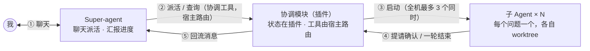
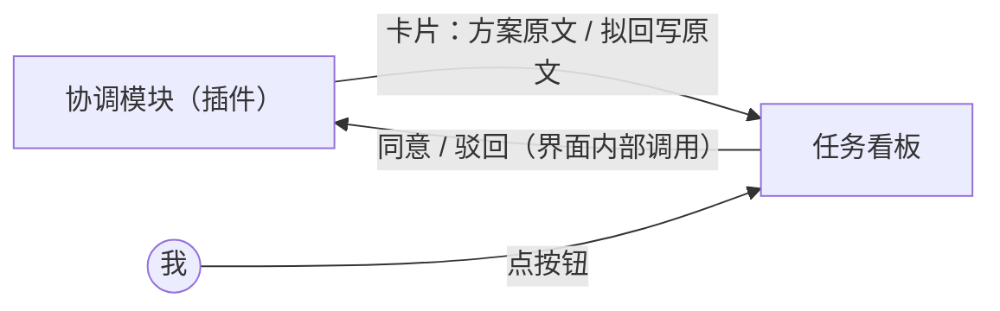
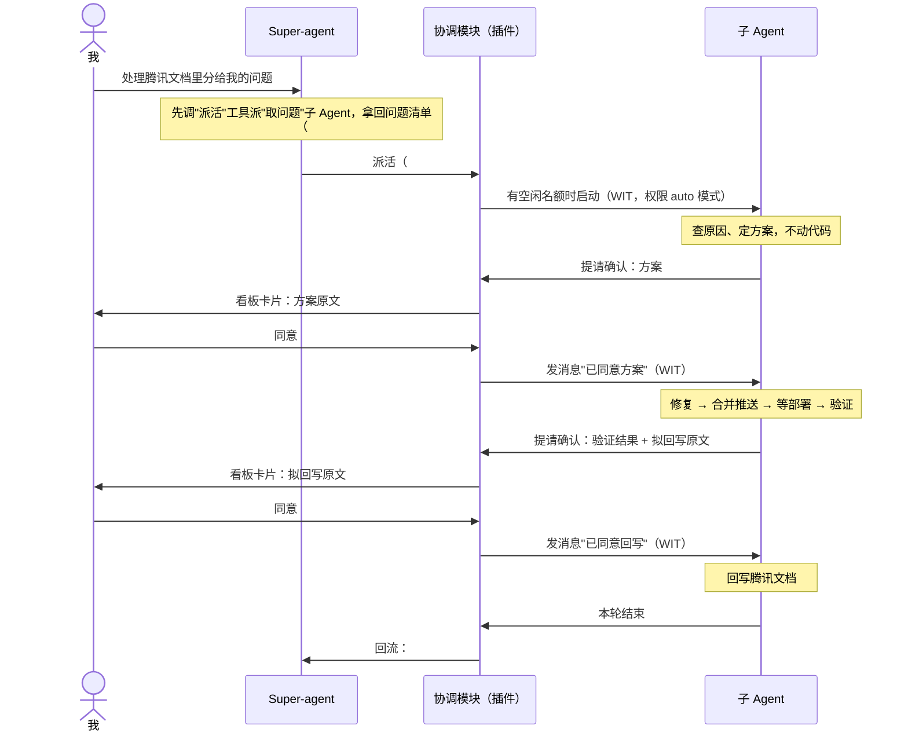
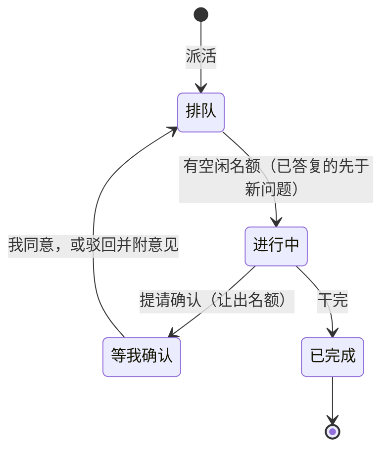

# Super-agent 设计（MVP）

> 我只在**一个会话**里和 Super-agent 聊天，在**一个看板**上确认。Super-agent 负责派活、汇报进度——协调能力由插件在背后提供；具体的活由子 Agent 完成。子 Agent 权限给足，但业务上不能自作主张：每个问题我确认两次，动手前看方案，回写前看结果。

本文档描述第一版（MVP）的完整范围。目标是尽快用上，没有待我决定的事项。暂不做的内容集中在第 10 节。

边界：本文只做**协调**（Super-agent ↔ 子 Agent 的派活、确认、回流）——这是产品；取问题、回写这些是我自己的业务场景，全部由技能（SOP）驱动，在文中作为示例出现，换场景只换技能。

## 1. 要解决的问题

每天有几十个问题登记在腾讯文档里（以后可能来自禅道、群聊）。现在的做法是一个问题开一个会话，手动复制问题描述，确认原因和方案后再修复、推送、验证、回写文档。会话一多就切换不过来，进度也管不住。

## 2. 怎么用（以我的腾讯文档问题处理为例）

1. 在 IDE 里新建一个 Super-agent 会话，对它说"处理腾讯文档里分给我的问题"。
2. Super-agent 自己不能执行命令，所以它先调"派活"工具派一个"取问题"子 Agent（插件在背后接住这个调用）。这个子 Agent 按技能（SOP）从腾讯文档取出问题，把每一行标成"处理中"，把问题清单作为回复交回。
3. Super-agent 拿到清单后逐个派活。一次派几十个也可以：整台机器同时最多运行 3 个，其余排队。
4. 每个问题对应一个子 Agent，在看板上是一张卡片。子 Agent 先查明原因、给出方案，不动代码（宿主的关卡拦着）。
5. **第一次确认**：子 Agent 调"提请确认"提交方案，卡片进入"等我确认"列，显示方案原文。我点同意，它才开始改代码。
6. 子 Agent 修复、合并到开发分支并推送（CI 自动部署）、到环境上验证。
7. **第二次确认**：子 Agent 再次提请确认，卡片显示验证结果和拟回写的原文。我点同意，它才回写腾讯文档。
8. 任何时候都可以问 Super-agent"进度怎么样"（它用"列表"工具查），或者点卡片标题（「等我确认」「进行中」的卡片也有「打开会话」按钮）跳到对应的子 Agent 会话看细节。

两次确认都可以驳回并附意见，子 Agent 按意见修改后再次提请确认。每个项目同时只有一个 Super-agent，不同项目可以各有一个（6.1）；批次就是先后几批活，都交给它派。

## 3. 架构

干活的主线：

确认的通道，不经过 Super-agent：

| 角色        | 是什么                                                                                                                            | 做什么                                                                               |
| ----------- | --------------------------------------------------------------------------------------------------------------------------------- | ------------------------------------------------------------------------------------ |
| Super-agent | 一个 Agent 会话（插件把它的编号记为协调者），每个项目一个，在项目根目录运行，没有 worktree                                        | 聊天派活、回答进度；**不能改文件、不能执行命令**（启动时就不给这类工具），不参与确认 |
| 子 Agent    | 一个 Agent 会话，每个问题一个，独立 worktree，权限 auto 模式（6.5）；"取问题"也是一个子 Agent                                     | 取问题；查原因、修复、推送、验证、回写；关键节点先提请确认                           |
| 协调模块    | 插件内的协调逻辑：四个协调工具的语义实现 + 全部状态（队列、归属、待确认）在插件 storage                                           | 派活、排队、回流、把待确认的内容送到看板；不含业务逻辑                               |
| 宿主（IDE） | 现有 IDE + 第 8 节补充的**无状态** WIT 能力（任务 API、协调工具路由、关卡执行、生命周期事件、调用者身份、打开会话、任务呈现属性） | 只认任务和启动参数，不存 Super-agent 的任何状态                                      |
| 任务看板    | 插件提供的编辑器区页签（web custom editor）                                                                                       | 展示所有子 Agent 的状态；确认；跳转到会话                                            |
| 技能（SOP） | 写给 Agent 的操作说明，放在我自己的技能目录                                                                                       | 去哪里取问题、什么时候提请确认、怎么验证、怎么回写；换来源只换技能                   |
| 腾讯文档    | 外部系统                                                                                                                          | 问题的来源，也是唯一的台账                                                           |

**形态定位：机制走 WIT，状态归插件，业务在技能。** Super-agent 以插件交付，随装随更，不依赖 IDE 发版；上游缺的能力全部以 WIT 接口补齐（第 8 节的 PR 系列），不做兼容层。**协调协议固化在插件里，开箱即用**：创建会话时注入内置的协调指令（工具怎么用、默认确认节点、事实从哪查），用户不写任何 SOP 就能派活、确认、回流；SOP 是可选的业务扩展，只承载场景事实（比如接腾讯文档台账）。派活靠聊天——LLM 决策，灵活；插件是它背后的账本和手：四个协调工具的**形状**定义在上游 WIT、调用由宿主**无状态路由**到插件，队列、归属、待确认内容这些**状态**全在插件的 storage。唯一绕不开的一跳：LLM 会话是独立进程、只认 MCP，协调工具必然经内置 MCP 服务进来。宿主只认"任务"和"启动参数"。

## 4. 一个问题的完整流程（示例：腾讯文档问题）

## 5. 看板与状态

看板有四列，每张卡片是一个子 Agent，卡片上标出所属的 Super-agent，可以按它筛选。点卡片标题跳转到它的会话。看板由插件提供：manifest 里 `customEditors` 声明一个 web custom editor（沙箱 iframe，页面经 `window.openidea.postMessage/onMessage` 与插件双向通信，参照 graphviz 插件），`host::open_editor` 打开它，就是编辑器区的一个页签——现有插件 API 够用，这块不用改宿主。

**看板形态已用原型对比敲定**：采用四列看板（状态驱动：一列一个状态，确认内容直接铺在卡片上，全局进度一目了然）。一起对比过的两个备选——按 Super-agent 分组的紧凑列表（先扫整体进度，需要时再展开单条）、只看待确认事项的收件箱（J/K/A/R 键盘流水线逐个清）——保留在 `docs/plan/prototype/super-agent-board.html`（`?variant=a|b|c` 切换，打开即有覆盖全部状态的演示数据），以后想换形态或做组合再翻。敲定的交互细节：

- 「等我确认」的卡片内联显示确认原文和「同意 / 驳回…」；它和「进行中」的卡片另有显式「打开会话 ↗」按钮，其余卡片点标题跳转。
- 同意、驳回、出错后继续都回到「排队」并标「已答复 · 优先」；重新提请确认时，卡片和明细里都带上次驳回意见，方便对出「它按意见改过了」。

图里只画了主线，其余规则：

- **等我确认**：子 Agent 调用了"提请确认"还没得到答复。子 Agent 用 auto 权限模式（6.5），常规命令不打扰我；claude 认为要问的命令会发权限请求，卡片同样进这一列，在看板上处理。
- **干完的判定**：子 Agent 一轮结束，且没有待确认的事。之后我再给它发消息，卡片回到"进行中"。
- **停止**：任何一张卡片都可以停止，停止后移到"已完成"列并标记为已停止。
- **驳回上限**：同一道关卡被驳回 3 次后，卡片标记为出错并回流通知 Super-agent，子 Agent 不再自动重试——防止一个修不好的问题在"驳回 → 修改 → 再确认"里无限循环烧 token。我在它的会话里发一句话（比如换路子的指示）即可继续。
- **自动归档**："已完成"列不无限堆积——卡片完成后闲置 7 天自动归档（活动定义为子 Agent 的会话轮次、终端输入、HEAD 移动），从看板消失；任务记录还在，需要时从会话列表找。
- **出错**：子 Agent 出错时，卡片进入"等我确认"列并标记为出错，同时让出名额。我进它的会话发一句话即可继续，继续时按下面"名额"一条重新排队。改坏了代码，任务页签里现有的「回滚更改」可以先把工作区复原（`rollback_changes`，`lib.rs:1358`）。
- **名额**：全机共用 3 个，不分 Super-agent。只有"进行中"的子 Agent 占名额，进入"等我确认"就让出，所以我不在时，队列照样往下走，各个问题各自停在"等我确认"。我同意或驳回后，这个子 Agent 要重新拿名额才能继续：名额满时它回到队列，排在所有新问题之前（先干完手上的，再开新的）。
- **Super-agent 的删除**：每个项目只有一个（6.1）。它还有未完结的子 Agent（排队、进行中、等我确认，含出错）时不能删除，提示先处理或停止这些子 Agent；都已完结（已完成、已停止）后可以删，只删它自己和还没送出的回流消息。万一它被绕过界面删掉（比如手工删任务文件），子 Agent 卡片保留，标为"无所属"，不再有回流，仍可在卡片上确认、停止。
- **重开会话（清空上下文）**：Super-agent 的上下文是易失的——真正的账在插件和台账，所以随时可以清空重聊：卡片上"重开会话"（Agent 任务 API，PR 1），同一任务换新会话，归属表、分组、子 Agent 原样保留，"列表"照样查到历史派活记录。查证路径内置在协调协议里：当前状态用"列表"，历史批次查台账（派子 Agent 去查），代码事实用只读工具或派子 Agent；场景特有的路径才进 SOP。要长期生效的业务约定写 SOP，别只说在聊天里。
- **IDE 重启**：见第 6.9 节。

## 6. 设计要点

> 本节的 `lib.rs` 均指 `crates/ide-agent/src/lib.rs`。

### 6.1 任务角色和归属

角色、归属这些协调状态**不进宿主**——宿主保持无状态，只认"任务"和"启动参数"。"任务编号 ↔ 角色 ↔ 归属"的绑定表记在**插件的 storage**（重启不丢，卸载即清）。插件的新建入口，以及协调工具里建任务、发消息这些动作，都走宿主新增的 Agent 任务 API（第 8 节 PR 1），创建参数带上启动选项：

| 创建参数       | 取值                                                                        | 用途                                                           |
| -------------- | --------------------------------------------------------------------------- | -------------------------------------------------------------- |
| 权限模式       | 协调者不设（没有工具，不会触发权限请求）；子 Agent：auto（6.5）             | 记进任务现有的 `wanted` 配置，重启后重新应用                   |
| 工具限制       | 协调者：只读三件套；子 Agent：不限制（claude 自带工具）                     | 宿主在拼启动参数处落到 `claude` 的参数上（6.2）                |
| MCP 工具可见性 | 协调者：派活、列表、发消息（+可选只读 IDE 工具）；子 Agent：提请确认（6.3） | 该任务的 MCP 配置里哪些内置工具可见，宿主按参数组装            |
| 确认关卡       | 可选：开 = 批准前禁止改文件与发布类命令                                     | 宿主内部生成 hooks 并经 `--settings` 传入（6.5），对插件不可见 |
| worktree       | 子 Agent：开                                                                | 沿用现有任务的隔离机制                                         |
| 内置指令       | 协调协议（工具用法、默认确认节点、查证路径），内容由插件内置                | 宿主追加到系统提示（`--append-system-prompt`）                 |
| 分组与置顶     | 子 Agent：分组 = 派它的 Super-agent；Super-agent 会话：置顶                 | 通用任务呈现属性（PR 6），宿主列表按组聚合、置顶浮顶           |

不用宿主的 `parent`：`conversation.rs` 里已有 `parent`，指 Agent 自己内部派出的子任务（如 Claude 的 `Task` 工具），和这里不是一回事；插件的归属表自己管自己。

每个项目最多一个协调者，由插件的新建入口保证：项目已有 Super-agent（用"列表"API 查得到）就直接打开它，不建第二个。新建时要求起一个名字（如"腾讯文档问题批"）——它就是分组名（PR 6），列表和看板都用它。这也是"取问题"不重复的根——两个 Super-agent 同时派"取问题"，谁都没来得及标"处理中"时会把同一批行取走两遍。子 Agent 不可能再派生 Super-agent：它的 MCP 工具可见性只有"提请确认"（6.3），没有派活的工具。

**在现有界面里的样子**：Super-agent 和子 Agent 都是真实任务，照常出现在现有的 Agents 列表和编辑器页签里——不是只能从看板或插件进，列表里也能直接打开、恢复。组织方式靠宿主新增的**任务分组与置顶**（PR 6，通用呈现属性）：插件创建任务时把分组设为派它的那个 Super-agent 的名字，Super-agent 会话置顶——列表里一个 Super-agent 一个组，组员是它的子 Agent，组头固定在最上面。分组名是任务的一个字符串属性，宿主按名聚合渲染，不新增"分组实体"；置顶是布尔属性。归属校验不受影响（仍查插件的归属表，6.4）。

### 6.2 Super-agent 不能改文件、不能执行命令

做法是根本不给它这类工具。宿主启动 Super-agent 的 `claude` 进程时（`crates/ide-agent/src/native/claude/mod.rs:644`，`Session::launch` 拼参数处），按 6.1 的创建参数追加：

| 参数                           | 作用                                                                                                                                      |
| ------------------------------ | ----------------------------------------------------------------------------------------------------------------------------------------- |
| `--tools "Read,Grep,Glob"`     | 内置工具只剩读文件和搜索，`Bash`、`PowerShell`、`Edit`、`Write` 等都不在工具列表里                                                        |
| `--strict-mcp-config`          | 只加载 IDE 经 `--mcp-config` 传入的 MCP 服务，不加载我在用户级配置的其他 MCP 服务                                                         |
| `--allowedTools mcp__OpenIDEA` | IDE 的 MCP 服务（名字是 `OpenIDEA`，见 `lib.rs:2751`）的工具调用不再逐次问我；它对协调者只开放协调工具和只读工具（6.3），全部放行是安全的 |

没有工具就无从调用，所以不需要拦截权限请求，权限模式和我预先放行过的命令也都不起作用。取问题因此也由子 Agent 来做。

### 6.3 协调工具

四个协调工具是**宿主原生的 MCP 工具**（派活、列表、发消息、提请确认），由上游的 WIT 定义形状、宿主路由：宿主的内置 MCP 服务收到调用后，带上调用者任务编号，转发给实现了标准 WIT 协调导出接口的插件——**形状在上游（WIT），状态在插件**（队列、归属、待确认内容都在插件的 storage）。每个 Agent 会话本来就经 `<exe> --mcp-stdio` 桥接接入这个服务。不做成插件自己的 mcpTools：那样工具调用要跨进插件运行时，受插件生命周期和调用预算影响，身份校验也会被拆到两处。

| 工具     | 谁能用   | 参数                                                              | 做什么                                                                   |
| -------- | -------- | ----------------------------------------------------------------- | ------------------------------------------------------------------------ |
| 派活     | 协调者   | 标题、问题原文、项目目录（默认 Super-agent 的项目）               | 建一个子 Agent 任务并入队，返回任务编号                                  |
| 列表     | 协调者   | 无                                                                | 返回自己派出的子 Agent：编号、标题、状态、最后一条回复的开头             |
| 发消息   | 协调者   | 任务编号、内容                                                    | 给自己派出的某个子 Agent 发一条消息                                      |
| 提请确认 | 子 Agent | 类型、内容（自由文本；默认协议给通用取值，业务场景可由 SOP 约定） | 把自己的卡片放进"等我确认"列并显示内容，立即返回；我的答复以消息形式送回 |

各角色能看到的工具，两道闸：**可见性**——协调工具默认不在任何会话的工具清单里（包括我自己随手开的普通 Agent 会话），只有插件入口创建、创建参数里点名的会话才注入（6.1，宿主按参数组装清单）；**越权拒绝**——就算调了，转发来的调用带着调用者任务编号，插件查归属表后拒绝：派活、列表、发消息只认协调者，且"列表"只能看到、"发消息"只能发给归属于自己的子 Agent——跨 Super-agent、查普通会话，一概不行：

| 谁                        | 看到的工具                                                  |
| ------------------------- | ----------------------------------------------------------- |
| Super-agent               | 派活、列表、发消息，以及原有的只读 IDE 工具（读代码、搜索） |
| 子 Agent                  | 只有"提请确认"                                              |
| 普通任务、外部 MCP 客户端 | 和现在一样，看不到协调工具（没有插件实现该导出即自动如此）  |

**前提：IDE 内置的 MCP 服务必须开着，插件已安装，项目必须是本地项目。** 这个服务可以在设置里关掉（`src-tauri/src/commands/mcp.rs`），关掉时 Agent 会话不注入任何 IDE 的 MCP 服务（`lib.rs:2749`），协调工具就不可用；远程项目目前也不支持内置 MCP 的工具调用。新建 Super-agent 时插件先检查：服务没开就提示我打开（或直接替我打开），远程项目不提供入口。

注入清单现在是"内置服务 + 我在 Settings › External MCP Servers 配的外部 MCP"（`crates/ide-agent/src/mcp.rs`，清单组装在 `lib.rs:146-151`）。给 Super-agent 和子 Agent 组装清单时只放内置服务，外部 MCP 一概不给：外部服务里可能有写工具，指向的还是主检出；子 Agent 读写代码用 `claude` 自带工具在自己的 worktree 里干。清单过滤落在宿主的创建参数处理里（仿照现有的按 provider 过滤，`mcp.rs:79` 的 `matches_agent`，加一层按创建参数的可见性过滤）。

子 Agent 看不到原有的 IDE 工具，是因为这些工具现在指向主检出（`mcp_servers_for` 传的是 `paths.project_root`），不是子 Agent 自己的 worktree，给了反而会让它读到、改到错误的代码。**内置工具按任务控制可见性**（子 Agent 只见"提请确认"、不见其他内置工具）是宿主要补的能力（第 8 节 PR 2）。

### 6.4 调用方身份

调用方身份就是任务编号，不另设令牌。任务编号本来就是随机生成的（`uuid::Uuid::new_v4()`，`lib.rs:690`），猜不到。角色和归属不在宿主（无状态，6.1），在插件的 storage；会话编号是任务文件里已有的 `session_id`。

1. IDE 启动一个 Agent 会话（包括 `--resume` 重启）时，把任务编号写进该任务 MCP 配置的环境变量。`stdio_mcp_servers`（`lib.rs:2748-2752`）现在是 `env: []`，改成带这一项；`claude` 驱动转换 MCP 配置时已经会带上 `env`（`native/claude/mod.rs:1468`），不用改。这是宿主内部实现，不出现在任何接口里。
2. 桥接进程（`crates/ide-mcp/src/stdio.rs`）读这个环境变量，在每个请求里多带一个请求头，和原有的全局令牌并存。
3. 协调工具的调用由宿主路由给插件（6.3），路由时带上调用者任务编号；宿主同时按该任务的创建参数控制工具可见性。
4. 插件收到路由调用后查自己的归属表再校验一次：派活、列表、发消息只对协调者有效，且发消息只能发给归属于自己的子 Agent；提请确认只对请求头里的那个任务生效，且该任务必须正在运行。
5. 两个上限：排队的问题总数上限 100，派活频率上限每分钟 30 次，防止被带偏的调用把队列塞满。上限在插件执行；每次协调调用宿主在日志里记下调用者的任务编号和动作。

**编号被翻出来的影响很小。** 同一个系统用户下的进程能互相读命令行和文件，一个子 Agent 专门去翻，能拿到 Super-agent 的编号冒充它，派活或给别的子 Agent 发消息。但子 Agent 本来就是 auto 模式（6.5），能执行绝大多数命令，冒充不会让它多出多少能力。真正要防的是 Super-agent 自己动手，这一点由 6.2 保证，和编号无关。

### 6.5 确认机制

协调提供的是通用机制：子 Agent 在任何需要我拍板的节点调"提请确认"（类型、内容自由），卡片进"等我确认"列，我的答复以消息送回。**默认确认节点内置在协调协议里**（动手改代码前确认方案——关卡强制；发布/回写类动作前确认），开箱即用；业务场景可用 SOP 增删节点——我的场景就定了两个（动手前看方案、回写前看结果），下文按这两个节点展开。

两次确认是业务上的确认，不是权限：子 Agent 用 auto 模式，大部分命令不打扰我，但 SOP 规定它到这两个节点必须先问我。

|                | 第一次：动手前                 | 第二次：回写前                           |
| -------------- | ------------------------------ | ---------------------------------------- |
| 时机           | 查明原因、定好方案，还没改代码 | 修复、推送、验证都做完，还没回写腾讯文档 |
| 提请确认的内容 | 原因和方案                     | 验证结果和拟回写的原文                   |
| 我同意后       | 它开始改代码                   | 它回写腾讯文档                           |

流程两次一样：

- 子 Agent 调用"提请确认"，工具立即返回，SOP 要求它随即结束本轮，不要等待、不要先动手。
- **用 Claude Code 的 hooks 兜底，不靠模型自觉。** 实测：模型被要求"调用后不要等待"时，会接着改文件。宿主启动子 Agent 时按创建参数里的关卡配置，用 `--settings` 传入一份按任务生成的 hooks 配置（不动我的用户级配置），其中两个 hook：
  - **停下这一轮**：`PostToolUse` hook，匹配"提请确认"，返回 `{"continue": false}`。这一轮在 `claude` 进程内就结束，不会有 IDE 发中断时可能"晚一步"的竞态。
  - **动手前的硬关卡**：`PreToolUse` hook，匹配 `Edit`、`Write`、`MultiEdit`、`NotebookEdit`，以及 `git commit`、`git merge`、`git push` 这类 `Bash` 命令；任务目录里没有"方案已同意"标记就拒绝，并在拒绝理由里提示"先调用提请确认"。我在看板上点同意方案时，插件经 Agent 任务 API 让宿主写下这个标记。hook 与权限模式无关，auto 模式下同样生效（已在全部放行模式下实测，见第 9 节）。
  - hook 命令是 IDE 可执行文件的一个子命令（和 `--mcp-stdio` 同一套做法，在 `main` 里提前处理并退出），读标记文件、输出 JSON。标记存在任务自己的目录里，会话重启、进程被停都不影响。
  - 回写腾讯文档那一步的关卡取决于 SOP 用哪个命令或工具回写，暂不做，仍靠 SOP（第 10 节）。
- 备选：在"提请确认"返回后由插件经 Agent 任务 API 发 `interrupt` 控制请求（`native/claude/mod.rs:870`）。同样实测有效，但有竞态，只在 hook 不可用时用。
- 卡片进入"等我确认"列并显示内容。等待期间它的进程可能因空闲被停掉，不影响。
- 我点同意或驳回（可附意见），插件经 Agent 任务 API 把结果作为一条消息发给它（进程已停就用 `--resume` 恢复，已实测可行），它再继续；驳回时按意见修改后再次提请确认。

子 Agent 创建时，协调模块把它的权限模式设为 **auto**（"Claude 自行决定什么要问"，`native/claude/settings.rs:36`），不是全部放行的 `bypassPermissions`——那个模式根本不发权限请求，IDE 现在的命令执行策略（`crates/ide-agent/src/security.rs`，黑名单拦 `rm -rf` 这类）会被整个绕过。auto 模式下：白名单里的命令自动放行，黑名单里的自动拒绝（拒绝理由写明命中的规则），claude 认为要问的发权限请求，卡片进"等我确认"列，我在看板上处理。子 Agent 启动参数同样带 `--allowedTools mcp__OpenIDEA`，"提请确认"的调用不逐次发权限请求（命令不受它影响，该问还问）。模式在创建参数里指定（6.1），宿主经现有的会话配置接口（`lib.rs:936`）设置，记进任务的 `wanted` 配置并存盘，会话重启后 IDE 会重新应用（`lib.rs:1946-2008`）。auto 是按模型提供的（`supportsAutoMode`，`settings.rs:65`）：模型不支持时回退 `bypassPermissions`，保批量不被打断，黑名单兜底就让位（第 7 节的弱点）。

**证据由宿主取证，不以子 Agent 自报为准。** 看板卡片和任务页签上的改动清单，用任务记录里宿主算出的文件变更（现有的 `changes` 机制，对着 worktree 的起点比对），不采信子 Agent 自己报的"我改了哪些文件"；它自述的"验证结果"照原样展示，但底下带着可点开的 diff——我核对的是证据，不只是它的话。

"取问题"子 Agent 的 SOP 不要求提请确认：取问题、标"处理中"不改代码，也是我让 Super-agent 去做的。

### 6.6 排队

- 队列由**插件**维护（storage）：派发顺序、"已答复 · 优先"的规则都在插件（第 5 节）。派活时插件调 Agent 任务 API 创建子 Agent 任务（不启动），问题原文存进任务记录，顺序记在插件。
- 名额的**硬上限在宿主执行**（第 8 节 PR 1）：全机最多 3 个插件派的任务同时运行——这只是对运行中任务的计数检查，不为宿主新增状态，插件记错账也不会超发。插件按自己的顺序调"启动"，宿主有空位就启动。3 个是整台机器的限制：每个子 Agent 一个 worktree，还可能有一次构建。
- 多个项目窗口各有一个插件实例时，派发顺序各自维护，硬上限全局生效，先到先得。

### 6.7 回流

子 Agent 提请确认、干完、出错时，插件往派它的那个 Super-agent 发一条消息，开头带固定标记（如"[子 Agent #12]"），和我发的消息区分开。Super-agent 不需要轮询。

- **事件来源**：一轮结束和出错在 `lib.rs` 的 `run` 循环（`lib.rs:1615-1626`），由宿主的生命周期事件（第 8 节 PR 4）带给插件；提请确认由插件自己的协调实现记录（6.3 的路由调用）。
- **内容**：干完的消息附上子 Agent 最后一条回复的正文（过长时截断并注明可用"列表"查看），这样"取问题"子 Agent 交回的清单能直接到 Super-agent 手里。
- **送达**：插件调 Agent 任务 API 的"发消息"（对应现有 `AgentManager::prompt(id, prompt, false)`，`lib.rs:846`）。Super-agent 空闲就立刻开一轮；正在忙就进它的消息队列，等这轮结束再送，不会打断我和它的对话。它的进程因空闲被停掉时，下一条消息会用 `--resume` 恢复会话（已实测）。
- **合并（必须做，在插件）**：现有队列每条消息单独占一轮（`lib.rs:1630`，每轮只取队首一条）。几十个子 Agent 陆续干完会让 Super-agent 连跑几十轮。所以插件自己攒事件：同一个 Super-agent 的上一条回流消息还没送出时，把新事件并进那条（取出重发），一条消息里写"#12、#15 已完成，#13 等确认"。不同 Super-agent 的事件不会合在一起。
- 队列里的回流消息会显示在 Super-agent 会话的"排队消息"里，我可以编辑或删除；删除只是丢了这条通知，看板上的状态不受影响。

### 6.8 台账、部署和技能（场景约定）

- **台账就是腾讯文档（我的场景）**：协调本身不关心台账在哪——IDE 里不存问题记录。SOP 规定"取问题"子 Agent 取出一行就把它标成"处理中"，并跳过已标记的行；修复的子 Agent 干完回写结果。这样不会重复派活，Super-agent 会话丢了也能从文档恢复。
- **部署不归子 Agent 管**：它把修复合并到开发分支并推送，CI 自动部署。几个子 Agent 同时推送时，后推的会被 Git 拒绝（不会覆盖别人的提交），SOP 规定被拒时先拉取合并再推。不需要 IDE 加锁。
- **业务在技能里，但技能是可选扩展，不是使用前提**：通用协调零 SOP 开箱即用（协议内置在插件，见第 3 节形态定位）。我的腾讯文档场景才需要技能文件（SKILL.md），放在我的用户级技能目录（本机惯例 `~/.agents/skills/<名称>/SKILL.md`，`.claude/skills/` 链接过去），claude 启动时自动发现——上下文随便清，场景规程不丢；不进 IDE 代码、不进插件仓库。

### 6.9 存盘与重启

任务本来就存盘：每个任务一个 `<任务编号>.json`（`lib.rs:1551` 的 `persist()`，原子写）。宿主无状态：任务文件里除了已有内容不加新东西；协调的状态全在插件的 storage（重启不丢，卸载即清），不另建数据库。

| 内容                                     | 存哪里                                                                                                 |
| ---------------------------------------- | ------------------------------------------------------------------------------------------------------ |
| 角色与归属（谁是协调者、谁派给谁）       | 插件的 storage（6.1）                                                                                  |
| 看板状态（所在列、提请确认的类型和内容） | 插件的 storage                                                                                         |
| 排队中的问题                             | 已建好的子 Agent 任务记录，状态为排队                                                                  |
| 待送给 Super-agent 的回流消息            | Super-agent 任务现有的 `queue` 字段                                                                    |
| 子 Agent 的权限模式                      | 现有的 `wanted` 配置                                                                                   |
| 对话内容、会话编号                       | 现有机制                                                                                               |
| 名额占用                                 | 不存，重启后按实际重新启动的数量重新数；已答复但还没拿到名额的任务记为"排队（优先）"，记在插件 storage |

重启后：插件从 storage 重建看板，用宿主的"列表"和事件对账（任务是唯一事实：任务在，卡片就在）；排队的问题按原顺序继续派，仍受 3 个的限制；原本在运行的子 Agent 按"出错"处理；原本"等我确认"的卡片保留，内容都在插件 storage 里，我点同意时宿主用 `--resume` 恢复该会话并发出答复。任务被删除时，文件和卡片一起消失（沿用现有行为），插件 storage 里的对应记账一并清掉。

### 6.10 固定的默认值

- Super-agent 和子 Agent 都用原生 `claude`，模型沿用我当前的默认模型。
- 子 Agent 权限模式为 auto，模型不支持时回退 `bypassPermissions`。
- 并发数固定为 3（宿主硬上限），排队上限 100（插件记账）；派活频率 30 次/分、驳回上限 3 次、归档闲置 7 天——均为默认值，插件设置里可调。
- 子 Agent 各自一个 worktree，随任务删除时一起清理（沿用现有任务的行为）。

## 7. 已知弱点

下面两点体验阶段可以接受，正式使用前按第 10 节补上。

| 弱点                                      | 后果                                                                                                                                      |
| ----------------------------------------- | ----------------------------------------------------------------------------------------------------------------------------------------- |
| SOP 约定的确认节点靠模型遵守，代码不强制  | 模型不守规矩时，技术上能跳过确认节点直接干活；关卡只保证批准前不动代码、不发布；我能在看板和会话里看到它在做什么，发现后停止              |
| 子 Agent 用 auto 模式，大部分命令不打扰我 | 命令执行策略只拦得住发权限请求的命令；claude 自动放行的和白名单放行的都不经过策略，黑名单外的危险命令仍可能被执行；发现不对时在看板上停止 |

## 8. 代码改动与上游 PR 系列

分工：**机制走 WIT、状态归插件、业务在技能**。宿主补的都是无状态的通用底座——只认"任务"和"启动参数"，不新增任何 Super-agent 业务状态（任务的通用呈现属性——分组、置顶、图标——与 `title` 同类，是任务自己的数据，见 PR 6）；每个 PR 独立可合。先在上游开 issue 附本设计对齐方向，再按顺序逐个提。

**上游（openidea 仓库，按合入顺序）：**

| PR  | 能力                | 内容                                                                                                                                                                                                                                                                                                                                                                   |
| --- | ------------------- | ---------------------------------------------------------------------------------------------------------------------------------------------------------------------------------------------------------------------------------------------------------------------------------------------------------------------------------------------------------------------- |
| 1   | Agent 任务管理 API  | 新 WIT `agent` 接口 + SDK：创建任务（创建参数：权限模式、工具限制、MCP 工具可见性、确认关卡配置、worktree、是否立即启动、内置指令）、启动（受全机并发上限约束）、发消息、列表、停止、变更清单（`changes`）、回滚、重开会话（同一任务换新会话：清空上下文，保留归属、分组与子 Agent）。宿主无新状态，只操作既有任务记录。`wit/` 现在没有任何 agent 接口，这是最大的一块 |
| 2   | 协调工具路由        | 内置 MCP 服务新增四个宿主原生协调工具（派活、列表、发消息、提请确认），宿主带调用者任务编号把调用转发给实现了标准 WIT 协调导出接口的插件——形状在上游、状态在插件；任务级 MCP 工具可见性按创建参数组装（6.3）                                                                                                                                                           |
| 3   | 确认关卡执行        | 创建参数里的关卡配置 → 宿主内部生成 hooks 并经 `--settings` 传入；Agent 任务 API 的"答复"写关卡标记。hook 子命令、标记文件都是宿主内部实现，不出现在任何接口里                                                                                                                                                                                                         |
| 4   | 任务生命周期事件    | 新事件类型（字符串 kind，`other(extension)` 载荷，不改接口形状）：启动、一轮结束（附最后回复）、出错、退出；插件的看板与回流靠它，不用轮询                                                                                                                                                                                                                             |
| 5   | 打开 Agent 会话 API | 看板点卡片跳到对应子 Agent 的会话页签（`open_editor` 只能开文件，开不了内置编辑器页签，需补）                                                                                                                                                                                                                                                                          |
| 6   | 任务呈现属性        | 任务新增三个通用呈现属性（与 `title` 同类，存任务记录）：`group`（分组名，宿主列表按名聚合渲染，不新增分组实体）、`pinned`（置顶）、`label`（徽标图标，渲染在**新增的独立槽位**、与现有引擎图标并排；未设置时不渲染，现有渲染路径一行不动）；创建参数可带、`agent.set_group/set_pinned/set_label` 可改；任何插件可用                                                   |

**插件（Super-agent 插件，独立仓库，`openidea-plugin` SDK：Rust → WASM）——状态与工具语义都在这：**

| 模块       | 内容                                                                                                                                                                                                     |
| ---------- | -------------------------------------------------------------------------------------------------------------------------------------------------------------------------------------------------------- |
| 协调状态   | 归属表（任务编号 ↔ 角色 ↔ 归属）、派发队列与顺序（"已答复 · 优先"）、名额记账、待确认内容、回流合并——全在插件 storage（6.1/6.6/6.7）                                                                     |
| 协调实现   | 实现 WIT 协调导出接口：四个工具的语义与归属校验（6.3/6.4）、两个上限（排队 100、每分钟 30 次）                                                                                                           |
| 任务看板   | web custom editor（`customEditors` + `web` 页，Vite 构建，参照 graphviz 插件）：四列、按 Super-agent 筛选、卡片上确认（`postMessage` → 插件 → Agent 任务 API）、点卡片打开会话（PR 5）                   |
| 入口与通知 | 新建 Super-agent 命令（起名，项目已有就打开不新建）、看板（首次创建后自动打开一次，平时命令或状态栏点击，`host::open_editor`）、状态栏 badge（待确认数）、设置页（并发、上限、驳回次数、归档天数都可调） |

## 9. 验证情况

已验证：

| 项                                                                                   | 怎么验证的                                                                                                                                                                    |
| ------------------------------------------------------------------------------------ | ----------------------------------------------------------------------------------------------------------------------------------------------------------------------------- |
| `--tools "Read,Grep,Glob"` + `--strict-mcp-config` 后只剩三个只读工具、没有 MCP 服务 | 本机 `claude` 2.1.319 实际启动，看它报出的工具列表；权限模式设成全部放行也一样                                                                                                |
| 限定工具后模型确实不能执行命令                                                       | 用 haiku 和默认模型各跑一次，让它写文件，都回复没有工具，文件没生成                                                                                                           |
| 进程退出后 `--resume` 能接上会话                                                     | 用 haiku 先存一个暗号，进程退出后恢复会话再问，答对                                                                                                                           |
| 会话忙时消息排队、空闲停进程后下一条消息恢复会话                                     | `ide-agent` 现有测试 `messages_sent_while_busy_are_queued_and_send_now_interrupts`、`idle_agents_stop_and_resume_their_session_on_the_next_message` 通过                      |
| MCP 配置的环境变量能传给桥接进程                                                     | 读代码：`native/claude/mod.rs:1468` 已转换 `env`                                                                                                                              |
| 记入 `wanted` 的权限模式重启后会重新应用                                             | 读代码：`lib.rs:936` 记入 `wanted`，`lib.rs:1946-2008` 启动时重新应用                                                                                                         |
| `--allowedTools mcp__OpenIDEA` 能让 MCP 工具调用不再发权限请求                       | 用和 IDE 驱动相同的方式（`stream-json` + `--permission-prompt-tool stdio`）跑 haiku：不加参数，工具调用触发一次 `can_use_tool` 请求；加上参数，没有请求，工具直接执行         |
| 经 MCP 配置的 `env` 把任务编号传给 MCP 服务进程                                      | 用模拟的 stdio MCP 服务实测：服务进程读到的环境变量和配置里写的一致，工具调用日志里记下了调用者编号                                                                           |
| 常驻进程模式（`stream-json`）下工具限定、MCP 配置、`--resume` 与 `-p` 模式一致       | 用 haiku 走 `stream-json`：`init` 报出的工具列表只有三个只读工具加 MCP 工具；被中断的会话用 `--resume` 恢复后能继续                                                           |
| 子 Agent 调"提请确认"后停下等答复                                                    | 用 haiku、权限全部放行，SOP 要求调用后结束本轮：3 次都停下了，没有改任何文件                                                                                                  |
| 子 Agent 不守规矩时，IDE 发中断能让它停下                                            | 故意写了"调用后不要等待、直接修"的 SOP：不兜底时它调完马上改了文件并跑了测试；在"提请确认"返回后立刻发 `interrupt` 控制请求，这一轮以 `error_during_execution` 结束，文件没改 |
| 被中断的会话收到答复后能继续干活                                                     | 用 `--resume` 发"我已同意方案"：它修改了代码、跑测试通过、再调"提请确认"（writeback）                                                                                         |
| `--settings` 传入的 `PostToolUse` hook 能停下这一轮                                  | 走 `stream-json`、全部放行、SOP 写成"调用后不要等待"：hook 返回 `{"continue": false}` 后这一轮结束（`stop_reason` 为 `tool_use`），文件没改                                   |
| `PreToolUse` hook 能在全部放行模式下拦住改文件和命令                                 | 未放标记：`Edit`、`Bash` 都被拒，文件没改，模型看到拒绝理由后自己去调了"提请确认"；放了标记：同样的任务正常改完、测试通过                                                     |

实现时要实测的：

以上用模拟的 MCP 服务和模拟 IDE 驱动的脚本验证，没有用真实的 IDE 内置 MCP 服务。真实服务做出来后各跑一遍：

1. 真实的 IDE 内置 MCP 服务经桥接进程接入后，上面的工具限定、放行、编号传递仍然成立。
2. 用真实的 SOP 和真实问题，看子 Agent 守不守"提请确认后停下"（测试里用的是 haiku 和一个玩具问题）。
3. 腾讯文档里有没有能写状态的列，没有就用备注列（SOP 层面的事）。
4. 一个问题要同时改多个仓库时怎么办：MVP 一个子 Agent 只绑定一个项目目录，需要时 Super-agent 拆成多个子 Agent。
5. auto 权限模式与命令执行策略的组合：白名单命令自动放行、黑名单命令自动拒绝并附原因、claude 要问的进"等我确认"列；`PreToolUse`/`PostToolUse` hook 在 auto 模式下照样生效。
6. 协调工具路由（PR 2）接通后：调用者身份传递、按创建参数的工具可见性、转发到插件、`--allowedTools` 免逐次确认都成立；看板 web 页与插件之间的 `postMessage` 通路；`host::open_editor` 打开看板页签。

## 10. 暂不做，体验之后再决定

| 项                       | 说明                                                                                                                                                                                                                             |
| ------------------------ | -------------------------------------------------------------------------------------------------------------------------------------------------------------------------------------------------------------------------------- |
| 回写前的硬关卡（场景）   | 动手前的关卡已用 hook 做了；回写腾讯文档这一步要拦，得知道 SOP 用哪个命令或工具回写，再加一条 `PreToolUse` 规则，或把回写做成只在我同意后由 IDE 执行的专用工具                                                                   |
| 动手前关卡拦只读命令     | 现在 `Bash` 只拦 `git commit/merge/push` 这类写操作；查原因阶段用 `Bash` 改文件（`sed -i`、重定向）拦不住，要拦得靠更严的命令白名单                                                                                              |
| 编号不暴露在命令行       | 把编号改走文件或管道传给桥接进程                                                                                                                                                                                                 |
| 子 Agent 也能用 IDE 工具 | 让 IDE 工具能指向子 Agent 的 worktree                                                                                                                                                                                            |
| 看门狗                   | 活跃的判定以"回合真正结束"为基线（自动重试、压缩、排队续作期间都算活跃，不能按墙钟硬杀）；空闲即注入心跳；超过阈值先发一条"收尾"消息让它汇报进度，仍无响应才标记卡住并通知 Super-agent。回合上限兜底：到顶先注入收尾指令、再中止 |
| 自动验收初筛             | 在"验证完"和"回写前确认"之间插一层自动初筛：按问题类型配验收标准（要点、通过阈值、返工上限），不过就自动返工，过了才进"等我确认"——人工只审初筛放行的，审的量大幅下降                                                             |
| 确认分档                 | 反复点同意的确认类别给出"以后同类自动同意"的建议（免审 / 每次问 / 首次问后记住 三档，可带参数通配）；auto 权限模式已覆盖工具层面，这里指的是业务关卡层面                                                                         |
| 碰撞通知                 | 一个子 Agent 改了别的子 Agent 读过的文件时，在看板上互相提醒，合并冲突早知道；目前部署冲突靠 SOP"被拒先拉后推"兜底                                                                                                               |
| 定时拉取（场景）         | 定时从腾讯文档取新问题                                                                                                                                                                                                           |
| 纯代码编排               | 流程跑稳后，可把派活从聊天改为插件代码直驱（省一次 LLM 决策），作为"批处理模式"的可选增强                                                                                                                                        |
| Super-agent 上下文治理   | 长会话轮次过多后插件提示重开会话或换代（都不丢账：归属在插件、台账在文档，见第 5 节"重开会话"）；claude 自带自动压缩兜长度，但要长期生效的约定应写进 SOP 而不是只说在聊天里                                                      |
| 其他 Agent 作为子 Agent  | 各家的权限语义不同，逐个验证后再开放                                                                                                                                                                                             |
| 编辑器区声明式视图扩展点 | 看板先用 web custom editor 承载（现有 API 够用，见第 5/8 节）；以后想要"不挂在文件上的纯视图页签"，再加一个 `location = "editor"` 的 views 扩展点（API 1.5 的扩展点机制可直接用）                                                |

## 11. 交付步骤

1. 在上游开 issue：说明场景、附本设计，对齐第 8 节 PR 系列的边界——机制走 WIT、宿主无状态、状态归插件、业务在技能。
2. 并行推进：上游按 PR 1 → 2 → 3 → 4 → 5 逐个提（每个只解决一个问题），PR 6（任务呈现属性）只依赖宿主前端，可独立随时提；插件先搭协调状态、看板和协调实现（对 WIT 接口打桩），PR 1/2 合入后接真。
3. 先做第 9 节"实现时要实测的"前两项。
4. 用真实的腾讯文档问题跑一两天。
5. 根据体验决定第 10 节补哪些。技能（SOP）不进上游、不进插件仓库，始终在我自己的技能目录。
