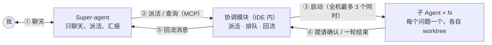
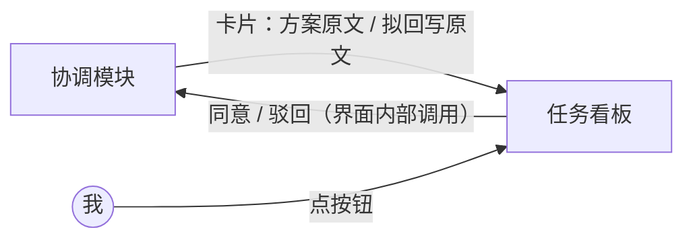
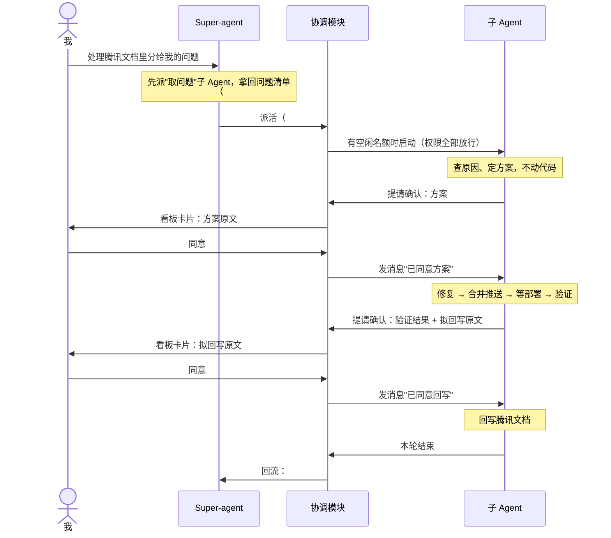
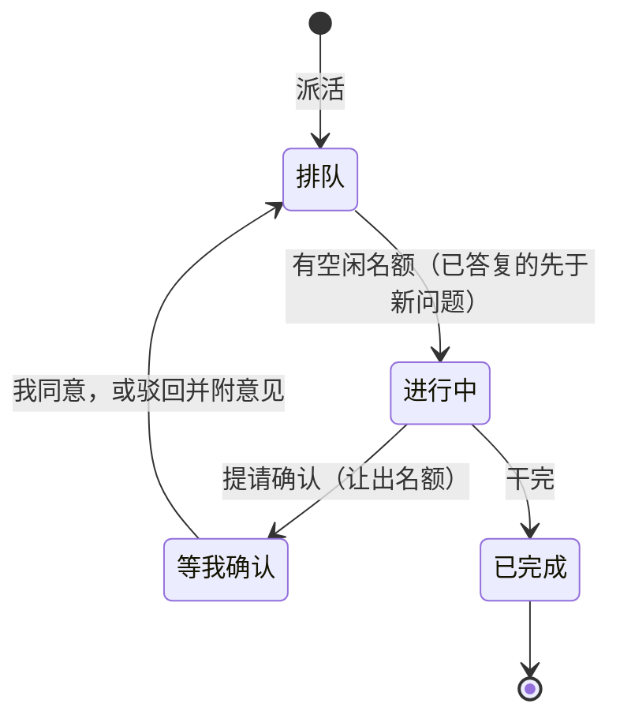

# Super-agent 设计（MVP）

> 我只在**一个会话**里和 Super-agent 聊天，在**一个看板**上确认。Super-agent 负责派活、汇报进度；具体的活由子 Agent 完成。子 Agent 权限给足，但业务上不能自作主张：每个问题我确认两次，动手前看方案，回写前看结果。

本文档描述第一版（MVP）的完整范围。目标是尽快用上，没有待我决定的事项。暂不做的内容集中在第 10 节。

## 1. 要解决的问题

每天有几十个问题登记在腾讯文档里（以后可能来自禅道、群聊）。现在的做法是一个问题开一个会话，手动复制问题描述，确认原因和方案后再修复、推送、验证、回写文档。会话一多就切换不过来，进度也管不住。

## 2. 怎么用

1. 在 IDE 里新建一个 Super-agent 会话，对它说"处理腾讯文档里分给我的问题"。
2. Super-agent 自己不能执行命令，所以它先派一个"取问题"子 Agent。这个子 Agent 按技能（SOP）从腾讯文档取出问题，把每一行标成"处理中"，最后把问题清单作为回复交回。
3. Super-agent 拿到清单后逐个派活。一次派几十个也可以：整台机器同时最多运行 3 个，其余排队。
4. 每个问题对应一个子 Agent，在看板上是一张卡片。子 Agent 先查明原因、给出方案，不动代码。
5. **第一次确认**：子 Agent 把方案提请确认，卡片进入"等我确认"列，显示方案原文。我点同意，它才开始改代码。
6. 子 Agent 修复、合并到开发分支并推送（CI 自动部署）、到环境上验证。
7. **第二次确认**：子 Agent 再次提请确认，卡片显示验证结果和拟回写的原文。我点同意，它才回写腾讯文档。
8. 任何时候都可以问 Super-agent"进度怎么样"，或者点卡片标题（「等我确认」「进行中」的卡片也有「打开会话」按钮）跳到对应的子 Agent 会话看细节。

两次确认都可以驳回并附意见，子 Agent 按意见修改后再次提请确认。Super-agent 可以同时开多个（比如不同项目、不同批次各一个），各管各的子 Agent。

## 3. 架构

干活的主线：

确认的通道，不经过 Super-agent：

| 角色        | 是什么                                                                               | 做什么                                                                           |
| ----------- | ------------------------------------------------------------------------------------ | -------------------------------------------------------------------------------- |
| Super-agent | 一个 Agent 会话，角色为协调者，在项目根目录运行，没有 worktree                       | 派活、回答进度；**不能改文件、不能执行命令**（启动时就不给这类工具），不参与确认 |
| 子 Agent    | 一个 Agent 会话，每个问题一个，独立 worktree，权限全部放行；"取问题"也是一个子 Agent | 取问题；查原因、修复、推送、验证、回写；关键节点先提请确认                       |
| 协调模块    | IDE 新增的代码（`crates/ide-agent`）                                                 | 派活、排队、回流、把待确认的内容送到看板；不含业务逻辑                           |
| 任务看板    | IDE 新增的界面（编辑器区的一个页签）                                                 | 展示所有子 Agent 的状态；确认；跳转到会话                                        |
| 技能（SOP） | 写给 Agent 的操作说明，放在我自己的技能目录                                          | 去哪里取问题、什么时候提请确认、怎么验证、怎么回写；换来源只换技能               |
| 腾讯文档    | 外部系统                                                                             | 问题的来源，也是唯一的台账                                                       |

## 4. 一个问题的完整流程

## 5. 看板与状态

看板有四列，每张卡片是一个子 Agent，卡片上标出所属的 Super-agent，可以按它筛选。点卡片标题跳转到它的会话。

**看板形态已用原型对比敲定**：采用四列看板（状态驱动：一列一个状态，确认内容直接铺在卡片上，全局进度一目了然）。一起对比过的两个备选——按 Super-agent 分组的紧凑列表（先扫整体进度，需要时再展开单条）、只看待确认事项的收件箱（J/K/A/R 键盘流水线逐个清）——保留在 `docs/plan/prototype/super-agent-board.html`（`?variant=a|b|c` 切换，打开即有覆盖全部状态的演示数据），以后想换形态或做组合再翻。敲定的交互细节：

- 「等我确认」的卡片内联显示确认原文和「同意 / 驳回…」；它和「进行中」的卡片另有显式「打开会话 ↗」按钮，其余卡片点标题跳转。
- 同意、驳回、出错后继续都回到「排队」并标「已答复 · 优先」；重新提请确认时，卡片和明细里都带上次驳回意见，方便对出「它按意见改过了」。

图里只画了主线，其余规则：

- **等我确认**：子 Agent 调用了"提请确认"还没得到答复。子 Agent 权限全部放行，正常不会有权限请求；万一有（比如某个工具不受这个模式管），卡片同样进这一列，在看板上处理。
- **干完的判定**：子 Agent 一轮结束，且没有待确认的事。之后我再给它发消息，卡片回到"进行中"。
- **停止**：任何一张卡片都可以停止，停止后移到"已完成"列并标记为已停止。
- **出错**：子 Agent 出错时，卡片进入"等我确认"列并标记为出错，同时让出名额。我进它的会话发一句话即可继续，继续时按下面"名额"一条重新排队。
- **名额**：全机共用 3 个，不分 Super-agent。只有"进行中"的子 Agent 占名额，进入"等我确认"就让出，所以我不在时，队列照样往下走，各个问题各自停在"等我确认"。我同意或驳回后，这个子 Agent 要重新拿名额才能继续：名额满时它回到队列，排在所有新问题之前（先干完手上的，再开新的）。
- **Super-agent 被删除**：它的子 Agent 卡片保留，标为"无所属"，不再有回流，我仍然可以在卡片上确认、停止。
- **IDE 重启**：见第 6.9 节。

## 6. 设计要点

### 6.1 任务角色和归属

Agent 任务（`AgentTask`，`crates/ide-agent/src/model.rs:52`）新增两个字段，都带 `#[serde(default)]`，旧任务文件照常能读，普通任务的行为完全不变：

| 字段          | 取值                                                          | 用途                                     |
| ------------- | ------------------------------------------------------------- | ---------------------------------------- |
| `role`        | 普通 / 协调者 / 子 Agent                                      | 决定启动参数和能看到的 MCP 工具          |
| `coordinator` | 派它的那个 Super-agent 的任务编号；Super-agent 和普通任务为空 | 回流送给谁、协调工具的归属校验、看板分组 |

字段不叫 `parent`，因为 `conversation.rs` 里已有 `parent`，指的是 Agent 自己内部派出的子任务（如 Claude 的 `Task` 工具），和这里不是一回事。

角色由 IDE 在创建任务时写入，`claude` 驱动在进程内运行，启动时从任务读角色，决定追加哪些启动参数（6.2）。

### 6.2 Super-agent 不能改文件、不能执行命令

做法是根本不给它这类工具。IDE 启动 Super-agent 的 `claude` 进程时（`crates/ide-agent/src/native/claude/mod.rs:640` 拼参数处）追加：

| 参数                           | 作用                                                                                                                                      |
| ------------------------------ | ----------------------------------------------------------------------------------------------------------------------------------------- |
| `--tools "Read,Grep,Glob"`     | 内置工具只剩读文件和搜索，`Bash`、`PowerShell`、`Edit`、`Write` 等都不在工具列表里                                                        |
| `--strict-mcp-config`          | 只加载 IDE 经 `--mcp-config` 传入的 MCP 服务，不加载我在用户级配置的其他 MCP 服务                                                         |
| `--allowedTools mcp__OpenIDEA` | IDE 的 MCP 服务（名字是 `OpenIDEA`，见 `lib.rs:2323`）的工具调用不再逐次问我；它对协调者只开放协调工具和只读工具（6.3），全部放行是安全的 |

没有工具就无从调用，所以不需要拦截权限请求，权限模式和我预先放行过的命令也都不起作用。取问题因此也由子 Agent 来做。

### 6.3 协调工具

协调工具加在 IDE 内置的 MCP 服务里（现在没有任何 Agent 相关的工具）。每个 Agent 会话本来就经 `<exe> --mcp-stdio` 桥接接入这个服务。

| 工具     | 谁能用   | 参数                                                | 做什么                                                                   |
| -------- | -------- | --------------------------------------------------- | ------------------------------------------------------------------------ |
| 派活     | 协调者   | 标题、问题原文、项目目录（默认 Super-agent 的项目） | 建一个子 Agent 任务并入队，返回任务编号                                  |
| 列表     | 协调者   | 无                                                  | 返回自己派出的子 Agent：编号、标题、状态、最后一条回复的开头             |
| 发消息   | 协调者   | 任务编号、内容                                      | 给自己派出的某个子 Agent 发一条消息                                      |
| 提请确认 | 子 Agent | 类型（方案 / 回写）、内容                           | 把自己的卡片放进"等我确认"列并显示内容，立即返回；我的答复以消息形式送回 |

各角色能看到的工具：

| 谁                        | 看到的工具                                                  |
| ------------------------- | ----------------------------------------------------------- |
| Super-agent               | 派活、列表、发消息，以及原有的只读 IDE 工具（读代码、搜索） |
| 子 Agent                  | 只有"提请确认"                                              |
| 普通任务、外部 MCP 客户端 | 和现在一样，看不到协调工具                                  |

**前提：IDE 内置的 MCP 服务必须开着，项目必须是本地项目。** 这个服务可以在设置里关掉（`src-tauri/src/commands/mcp.rs`），关掉时 Agent 会话不注入任何 IDE 的 MCP 服务（`lib.rs:2303`），Super-agent 就没有协调工具可用；远程项目目前也不支持内置 MCP 的工具调用。所以新建 Super-agent 时先检查：服务没开就提示我打开（或直接替我打开），远程项目不提供 Super-agent 入口。

子 Agent 看不到原有的 IDE 工具，是因为这些工具现在指向主检出（`mcp_servers_for` 传的是 `paths.project_root`），不是子 Agent 自己的 worktree，给了反而会让它读到、改到错误的代码。子 Agent 读写代码用 `claude` 自带的工具，它们在 worktree 里工作。

### 6.4 调用方身份

调用方身份就是任务编号，不另设令牌。任务编号本来就是随机生成的（`uuid::Uuid::new_v4()`，`lib.rs:581`），猜不到。任务记录本身就是"任务编号 ↔ 角色 ↔ Agent 会话编号"的绑定表：编号在 `AgentTask.id`，角色和归属是 6.1 的新字段，会话编号是任务文件里已有的 `session_id`。

1. IDE 启动一个 Agent 会话（包括 `--resume` 重启）时，把任务编号写进该任务 MCP 配置的环境变量。`stdio_mcp_servers`（`lib.rs:2323`）现在是 `env: []`，改成带这一项；`claude` 驱动转换 MCP 配置时已经会带上 `env`（`native/claude/mod.rs:1440`），不用改。
2. 桥接进程（`crates/ide-mcp/src/stdio.rs`）读这个环境变量，在每个请求里多带一个请求头，和原有的全局令牌并存。
3. 服务端用编号查任务记录，得到角色，决定给哪些工具。查不到的只给原有工具。
4. 每个工具再校验一次：派活、列表、发消息只对协调者有效，且发消息只能发给 `coordinator` 是自己的子 Agent；提请确认只对请求头里的那个任务生效，且该任务必须正在运行。
5. 两个上限：排队的问题总数上限 100，派活频率上限每分钟 30 次，防止被带偏的调用把队列塞满。每次协调工具调用都在 IDE 日志里记下调用者的任务编号和动作。

**编号被翻出来的影响很小。** 同一个系统用户下的进程能互相读命令行和文件，一个子 Agent 专门去翻，能拿到 Super-agent 的编号冒充它，派活或给别的子 Agent 发消息。但子 Agent 本来就是全部放行，能执行任何命令，冒充不会让它多出任何能力。真正要防的是 Super-agent 自己动手，这一点由 6.2 保证，和编号无关。

### 6.5 两次确认

两次确认是业务上的确认，不是权限：子 Agent 权限全部放行，它能做，但 SOP 规定它到这两个节点必须先问我。

|                | 第一次：动手前                 | 第二次：回写前                           |
| -------------- | ------------------------------ | ---------------------------------------- |
| 时机           | 查明原因、定好方案，还没改代码 | 修复、推送、验证都做完，还没回写腾讯文档 |
| 提请确认的内容 | 原因和方案                     | 验证结果和拟回写的原文                   |
| 我同意后       | 它开始改代码                   | 它回写腾讯文档                           |

流程两次一样：

- 子 Agent 调用"提请确认"，工具立即返回，SOP 要求它随即结束本轮，不要等待、不要先动手。
- **用 Claude Code 的 hooks 兜底，不靠模型自觉。** 实测：模型被要求"调用后不要等待"时，会接着改文件。IDE 启动子 Agent 时用 `--settings` 传入一份按任务生成的 hooks 配置（不动我的用户级配置），其中两个 hook：
  - **停下这一轮**：`PostToolUse` hook，匹配"提请确认"，返回 `{"continue": false}`。这一轮在 `claude` 进程内就结束，不会有 IDE 发中断时可能"晚一步"的竞态。
  - **动手前的硬关卡**：`PreToolUse` hook，匹配 `Edit`、`Write`、`MultiEdit`、`NotebookEdit`，以及 `git commit`、`git merge`、`git push` 这类 `Bash` 命令；任务目录里没有"方案已同意"标记就拒绝，并在拒绝理由里提示"先调用提请确认"。我在看板上点同意方案时，IDE 写下这个标记。全部放行模式下 hook 照样生效。
  - hook 命令是 IDE 可执行文件的一个子命令（和 `--mcp-stdio` 同一套做法，在 `main` 里提前处理并退出），读标记文件、输出 JSON。标记存在任务自己的目录里，会话重启、进程被停都不影响。
  - 回写腾讯文档那一步的关卡取决于 SOP 用哪个命令或工具回写，暂不做，仍靠 SOP（第 10 节）。
- 备选：在"提请确认"返回后由协调模块发 `interrupt` 控制请求（`native/claude/mod.rs:858`）。同样实测有效，但有竞态，只在 hook 不可用时用。
- 卡片进入"等我确认"列并显示内容。等待期间它的进程可能因空闲被停掉，不影响。
- 我点同意或驳回（可附意见），协调模块把结果作为一条消息发给它（进程已停就用 `--resume` 恢复，已实测可行），它再继续；驳回时按意见修改后再次提请确认。

子 Agent 创建时，协调模块把它的权限模式设为全部放行（`bypassPermissions`），走 IDE 现有的会话配置接口。这样设的模式会记进任务的 `wanted` 配置并存盘，会话重启后 IDE 会重新应用（`lib.rs:742`、`lib.rs:1596`）。原生 `claude` 启动时已带 `--allow-dangerously-skip-permissions`，允许这个模式。

"取问题"子 Agent 的 SOP 不要求提请确认：取问题、标"处理中"不改代码，也是我让 Super-agent 去做的。

### 6.6 排队

- 协调模块维护一个全局队列，所有 Super-agent 派的活都进同一个队列，按入队先后排。
- 派活时就建好子 Agent 的任务记录（状态为排队，存下问题原文），只是不启动进程。
- 全机运行中的子 Agent 少于 3 个时，取队首启动。3 个是整台机器的限制：每个子 Agent 一个 worktree，还可能有一次构建。

### 6.7 回流

子 Agent 提请确认、干完、出错时，协调模块往它的 `coordinator` 那个 Super-agent 发一条消息，开头带固定标记（如"[子 Agent #12]"），和我发的消息区分开。Super-agent 不需要轮询。

- **事件来源**：一轮结束和出错在 `lib.rs` 的 `run` 循环（`lib.rs:1280`）；提请确认由协调工具自己记录。协调模块在这两处挂钩。
- **内容**：干完的消息附上子 Agent 最后一条回复的正文（过长时截断并注明可用"列表"查看），这样"取问题"子 Agent 交回的清单能直接到 Super-agent 手里。
- **送达**：用现有的 `AgentManager::prompt(id, prompt, false)`（`lib.rs:624`）。Super-agent 空闲就立刻开一轮；正在忙就进它的消息队列，等这轮结束再送，不会打断我和它的对话。它的进程因空闲被停掉时，下一条消息会用 `--resume` 恢复会话（已实测）。
- **合并（必须做）**：现有队列每条消息单独占一轮（`lib.rs:1295`，每轮只取队首一条）。几十个子 Agent 陆续干完会让 Super-agent 连跑几十轮。所以协调模块自己攒事件：同一个 Super-agent 的队列里已有一条回流消息还没送出时，把新事件并进那条（取出重发），一条消息里写"#12、#15 已完成，#13 等确认"。不同 Super-agent 的事件不会合在一起。
- 队列里的回流消息会显示在 Super-agent 会话的"排队消息"里，我可以编辑或删除；删除只是丢了这条通知，看板上的状态不受影响。

### 6.8 台账、部署和技能

- **台账就是腾讯文档**：IDE 里不存问题记录。SOP 规定"取问题"子 Agent 取出一行就把它标成"处理中"，并跳过已标记的行；修复的子 Agent 干完回写结果。这样不会重复派活，Super-agent 会话丢了也能从文档恢复。
- **部署不归子 Agent 管**：它把修复合并到开发分支并推送，CI 自动部署。几个子 Agent 同时推送时，后推的会被 Git 拒绝（不会覆盖别人的提交），SOP 规定被拒时先拉取合并再推。不需要 IDE 加锁。
- **业务都在技能里**：取问题、什么时候提请确认、验证、回写的具体做法写在我的技能目录里，不进 IDE 代码。

### 6.9 存盘与重启

任务本来就存盘：每个任务一个 `<任务编号>.json`（`lib.rs:1217` 的 `persist()`，原子写）。协调相关的内容都跟着任务走，不另建数据库。

| 内容                                     | 存哪里                                                                                     |
| ---------------------------------------- | ------------------------------------------------------------------------------------------ |
| `role`、`coordinator`                    | `AgentTask` 新字段                                                                         |
| 看板状态（所在列、提请确认的类型和内容） | `AgentTask` 新字段                                                                         |
| 排队中的问题                             | 已建好的子 Agent 任务记录，状态为排队                                                      |
| 待送给 Super-agent 的回流消息            | Super-agent 任务现有的 `queue` 字段                                                        |
| 子 Agent 的权限模式                      | 现有的 `wanted` 配置                                                                       |
| 对话内容、会话编号                       | 现有机制                                                                                   |
| 名额占用                                 | 不存，重启后按实际重新启动的数量重新数；已答复但还没拿到名额的任务记为"排队（优先）"，存盘 |

重启后：从任务文件重建看板；排队的问题按原顺序继续派，仍受 3 个的限制；原本在运行的子 Agent 按"出错"处理；原本"等我确认"的卡片保留，内容都在任务文件里，我点同意时 IDE 用 `--resume` 恢复该会话并发出答复。任务被删除时，文件和卡片一起消失（沿用现有行为）。

### 6.10 固定的默认值

- Super-agent 和子 Agent 都用原生 `claude`，模型沿用我当前的默认模型。
- 子 Agent 权限模式为全部放行。
- 并发数固定为 3，排队上限 100。
- 子 Agent 各自一个 worktree，随任务删除时一起清理（沿用现有任务的行为）。

## 7. 已知弱点

下面两点体验阶段可以接受，正式使用前按第 10 节补上。

| 弱点                           | 后果                                                                                                                      |
| ------------------------------ | ------------------------------------------------------------------------------------------------------------------------- |
| 回写前的确认靠 SOP，代码不强制 | 子 Agent 不守规矩时，技术上能不问我就直接回写；动手前的确认已有 hook 硬关卡；我能在看板和会话里看到它在做什么，发现后停止 |
| 子 Agent 权限全部放行          | 它执行什么命令都不问我；这是我现在的用法，批量处理也需要这样                                                              |

## 8. 代码改动

| 位置                         | 改动                                                                                                                                                                                                                                                                           |
| ---------------------------- | ------------------------------------------------------------------------------------------------------------------------------------------------------------------------------------------------------------------------------------------------------------------------------ |
| `crates/ide-agent`           | `AgentTask` 新增 `role`、`coordinator`、看板状态；新增协调模块（队列、名额、回流与合并、待确认状态）；按角色追加 `claude` 启动参数；创建子 Agent 时把权限模式设为全部放行；MCP 配置的环境变量带上任务编号；按任务生成 hooks 配置并经 `--settings` 传入；点同意方案时写标记文件 |
| `src-tauri` / 可执行文件入口 | 新增 hook 子命令（读标记文件、输出 JSON），在 `main` 里提前处理并退出                                                                                                                                                                                                          |
| `crates/ide-mcp`             | 桥接进程读环境变量，随每个请求带任务编号请求头；服务端把编号交给 `ToolRegistry`，新增带调用方的列表和调用方法（给默认实现，不影响现有实现和插件提供的工具）                                                                                                                    |
| `crates/ide-host/src/mcp`    | 用编号查出任务和角色，按角色过滤工具；新增四个协调工具，各自校验角色和归属；记日志                                                                                                                                                                                             |
| `src/features/agents`        | 新建 Super-agent 的入口；任务看板页签（四列、按 Super-agent 筛选、卡片上确认、点标题或「打开会话」按钮跳转）                                                                                                                                                                   |

## 9. 验证情况

已验证：

| 项                                                                                   | 怎么验证的                                                                                                                                                                    |
| ------------------------------------------------------------------------------------ | ----------------------------------------------------------------------------------------------------------------------------------------------------------------------------- |
| `--tools "Read,Grep,Glob"` + `--strict-mcp-config` 后只剩三个只读工具、没有 MCP 服务 | 本机 `claude` 2.1.319 实际启动，看它报出的工具列表；权限模式设成全部放行也一样                                                                                                |
| 限定工具后模型确实不能执行命令                                                       | 用 haiku 和默认模型各跑一次，让它写文件，都回复没有工具，文件没生成                                                                                                           |
| 进程退出后 `--resume` 能接上会话                                                     | 用 haiku 先存一个暗号，进程退出后恢复会话再问，答对                                                                                                                           |
| 会话忙时消息排队、空闲停进程后下一条消息恢复会话                                     | `ide-agent` 现有测试 `messages_sent_while_busy_are_queued_and_send_now_interrupts`、`idle_agents_stop_and_resume_their_session_on_the_next_message` 通过                      |
| MCP 配置的环境变量能传给桥接进程                                                     | 读代码：`native/claude/mod.rs:1440` 已转换 `env`                                                                                                                              |
| 记入 `wanted` 的权限模式重启后会重新应用                                             | 读代码：`lib.rs:742` 记入 `wanted`，`lib.rs:1596` 启动时重新应用                                                                                                              |
| `--allowedTools mcp__OpenIDEA` 能让 MCP 工具调用不再发权限请求                       | 用和 IDE 驱动相同的方式（`stream-json` + `--permission-prompt-tool stdio`）跑 haiku：不加参数，工具调用触发一次 `can_use_tool` 请求；加上参数，没有请求，工具直接执行         |
| 经 MCP 配置的 `env` 把任务编号传给 MCP 服务进程                                      | 用模拟的 stdio MCP 服务实测：服务进程读到的环境变量和配置里写的一致，工具调用日志里记下了调用者编号                                                                           |
| 常驻进程模式（`stream-json`）下工具限定、MCP 配置、`--resume` 与 `-p` 模式一致       | 用 haiku 走 `stream-json`：`init` 报出的工具列表只有三个只读工具加 MCP 工具；被中断的会话用 `--resume` 恢复后能继续                                                           |
| 子 Agent 调"提请确认"后停下等答复                                                    | 用 haiku、权限全部放行，SOP 要求调用后结束本轮：3 次都停下了，没有改任何文件                                                                                                  |
| 子 Agent 不守规矩时，IDE 发中断能让它停下                                            | 故意写了"调用后不要等待、直接修"的 SOP：不兜底时它调完马上改了文件并跑了测试；在"提请确认"返回后立刻发 `interrupt` 控制请求，这一轮以 `error_during_execution` 结束，文件没改 |
| 被中断的会话收到答复后能继续干活                                                     | 用 `--resume` 发"我已同意方案"：它修改了代码、跑测试通过、再调"提请确认"（writeback）                                                                                         |
| `--settings` 传入的 `PostToolUse` hook 能停下这一轮                                  | 走 `stream-json`、全部放行、SOP 写成"调用后不要等待"：hook 返回 `{"continue": false}` 后这一轮结束（`stop_reason` 为 `tool_use`），文件没改                                   |
| `PreToolUse` hook 能在全部放行模式下拦住改文件和命令                                 | 未放标记：`Edit`、`Bash` 都被拒，文件没改，模型看到拒绝理由后自己去调了"提请确认"；放了标记：同样的任务正常改完、测试通过                                                     |

实现时要实测的：

以上用模拟的 MCP 服务和模拟 IDE 驱动的脚本验证，没有用真实的 IDE 内置 MCP 服务。真实服务做出来后各跑一遍：

1. 真实的 IDE 内置 MCP 服务经桥接进程接入后，上面的工具限定、放行、编号传递仍然成立。
2. 用真实的 SOP 和真实问题，看子 Agent 守不守"提请确认后停下"（测试里用的是 haiku 和一个玩具问题）。
3. 腾讯文档里有没有能写状态的列，没有就用备注列（SOP 层面的事）。
4. 一个问题要同时改多个仓库时怎么办：MVP 一个子 Agent 只绑定一个项目目录，需要时 Super-agent 拆成多个子 Agent。

## 10. 暂不做，体验之后再决定

| 项                       | 说明                                                                                                                                                           |
| ------------------------ | -------------------------------------------------------------------------------------------------------------------------------------------------------------- |
| 回写前的硬关卡           | 动手前的关卡已用 hook 做了；回写腾讯文档这一步要拦，得知道 SOP 用哪个命令或工具回写，再加一条 `PreToolUse` 规则，或把回写做成只在我同意后由 IDE 执行的专用工具 |
| 动手前关卡拦只读命令     | 现在 `Bash` 只拦 `git commit/merge/push` 这类写操作；查原因阶段用 `Bash` 改文件（`sed -i`、重定向）拦不住，要拦得靠更严的命令白名单                            |
| 编号不暴露在命令行       | 把编号改走文件或管道传给桥接进程                                                                                                                               |
| 子 Agent 也能用 IDE 工具 | 让 IDE 工具能指向子 Agent 的 worktree                                                                                                                          |
| 看门狗                   | 子 Agent 超过 30 分钟无输出且没有后台任务时，标记为卡住并通知 Super-agent                                                                                      |
| 定时拉取                 | 定时从腾讯文档取新问题                                                                                                                                         |
| 其他 Agent 作为子 Agent  | 各家的权限语义不同，逐个验证后再开放                                                                                                                           |
| 插件化                   | 新增 `agent-session` 事件类型（事件类型是字符串，不改插件接口），看板和协调工具可迁到插件                                                                      |

## 11. 交付步骤

1. 建一个 worktree，在本地分支上实现第 6 节的内容。
2. 先做第 9 节"实现时要实测的"前两项。
3. 用真实的腾讯文档问题跑一两天。
4. 根据体验决定第 10 节补哪些。
5. 想贡献给上游时：先开 issue 说明场景并附上本设计，方向确认后按"一个 PR 只解决一个问题"拆分提交。技能（SOP）不进上游。
